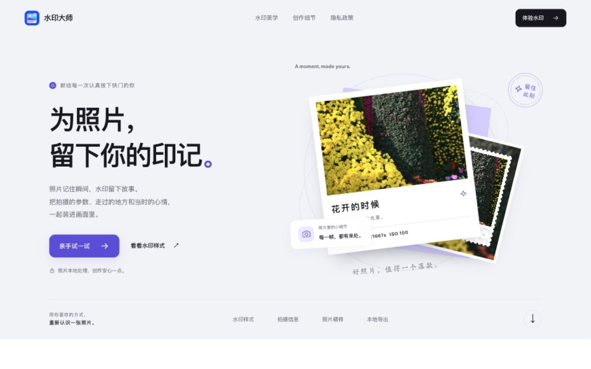
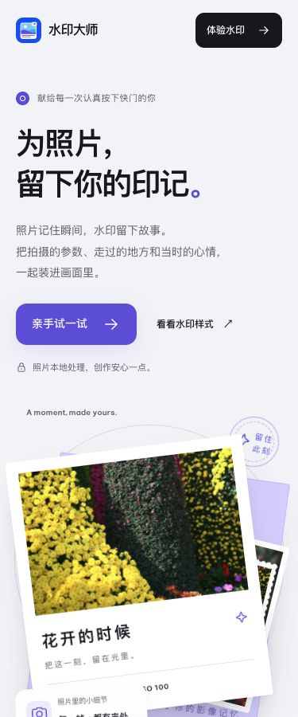
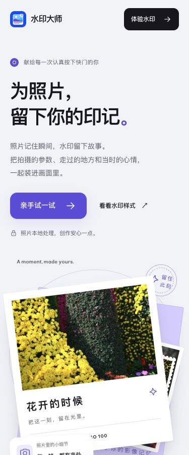
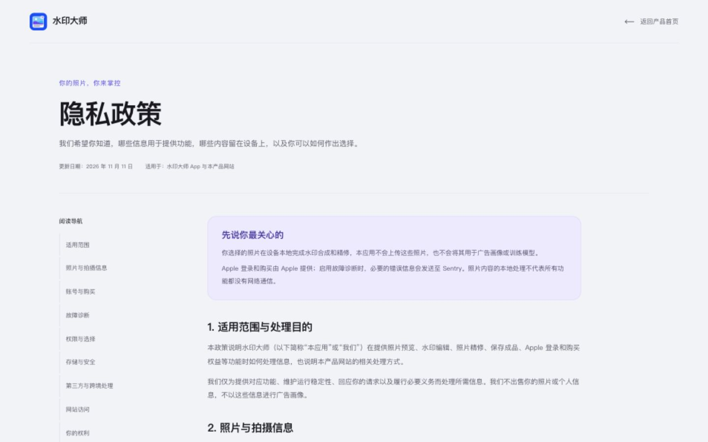

# 原版与 Vue 版 UI / 交互对比

验证日期：2026-11-11。原版为 `photo-watermark/web`，迁移版为本项目 Vue 3 + Motion 实现。

## 结论

本轮检查的静态 UI 与功能操作结果已对齐。首页在五种宽度下比较了 54 个关键元素，共 270 组元素对照；位置、尺寸、字号、行高、文字颜色和背景色均未发现超过 0.5 CSS 像素的几何差异或样式差异。两页均进行了浏览器实际操作与截图复核。

这表示已检查状态的一致性，不是每一帧动画或所有浏览器环境的像素完全相同。迁移动效由 Motion 重写，保留原来的视觉反馈与最终状态。

## 对比范围

| 项目           | 检查方式                                                   | 结果                                                   |
| -------------- | ---------------------------------------------------------- | ------------------------------------------------------ |
| 首页响应式布局 | 320、375、768、1024、1440 CSS 像素；每种宽度 54 个关键元素 | 一致，无横向溢出                                       |
| 页面素材       | 对比全部 10 个本地图片 / 字体文件的 SHA-256                | 逐字节一致                                             |
| 图集筛选       | 全部 8、基础 3、Pro 5；名称、排序、卡片底色                | 一致                                                   |
| 水印预览       | 经典 / 留白 / 邮票 × 纸白 / 墨黑，共 6 种组合              | 文案、前景背景色、预览尺寸一致                         |
| 文字边界       | 空值、全空格、表情、中英文数字；真实逐字输入超过 18 字     | 默认文案与计数一致，实际输入上限均为 18 个 UTF-16 单元 |
| 饱和度         | Home 到 0%、End 到 160%、ArrowLeft 到 159%                 | 数值、输出与 CSS filter 一致                           |
| 一键恢复       | 还原标题、经典版式、纸白与 100% 饱和度                     | 一致                                                   |
| 图片弹窗       | 经典影像与旅行邮票，分别检查标题、描述、图片、尺寸         | 一致；浮点几何差异最大约 0.00055px                     |
| 弹窗关闭       | Escape、关闭按钮、点击背景，检查焦点返回与解除滚动锁定     | 一致                                                   |
| FAQ            | 同时展开前两项，比较正文和展开后的页面几何                 | 一致                                                   |
| 隐私政策       | 1440、375 宽度下的布局、正文与全部正文链接                 | 一致                                                   |
| 隐私目录       | 联系我们章节跳转与邮箱入口                                 | 正常                                                   |
| 实际生产构建与 Pages 子路径 | 使用目标工程 dist，在 `/photo-watermark-site/` 下检查首页、筛选、资源加载与 privacy.html | 通过；生产首页的 54 个关键元素对照无差异，隐私页 12 章正常加载，控制台无报错 |
| 工程检查       | ESLint、vue-tsc 和 Vite 生产构建                           | 通过                                                   |

文字长度与网页原有的 `maxlength="18"` 行为一致，例如一个表情可能占两个 UTF-16 单元。测试自动填充值与实际键盘输入分开检查，避免把自动化工具绕过原生 maxlength 的行为误判成产品差异。

## 对比中发现并修正的差异

1. **FAQ 同时展开规则**：初始 Vue 实现只允许打开一项，已改为独立管理每项状态，与原版多项同时展开一致。
2. **筛选后的卡片底色**：Vue 移除筛选项会改变 `nth-child` 位置，曾导致“留白经典”底色变化。现按原始样式顺序绑定底色，筛选不会改色。
3. **工作台即时反馈**：初始实现用等待退出的组件切换，短暂保留旧预览。现保留同一预览节点，立即更新响应式数据，仅通过 Motion 执行轻微淡入与位移。
4. **悬停反馈**：图集恢复为图片轻微放大并旋转，文字链接恢复箭头位移，使用 Motion 实现。

## 截图

截图在相同视口、页面初始状态、入场动效结束后取得。图片用于人工复核；没有把 JPEG 差异当作逐像素一致性结论。

| 原静态版，1440px                              | Vue 版，1440px                           |
| --------------------------------------------- | ---------------------------------------- |
|  |  |

| 原静态版，375px                              | Vue 版，375px                           |
| -------------------------------------------- | --------------------------------------- |
|  |  |

| 原静态隐私页                                   | Vue 隐私页                                |
| ---------------------------------------------- | ----------------------------------------- |
|  |  |

完整测量摘要见 [comparison-results.json](comparison-results.json)。

验证环境为本机浏览器；系统“减少动态效果”通过 Motion 配置与代码核对，本轮没有切换操作系统设置或在 iOS / Android 真机浏览器上测试。
